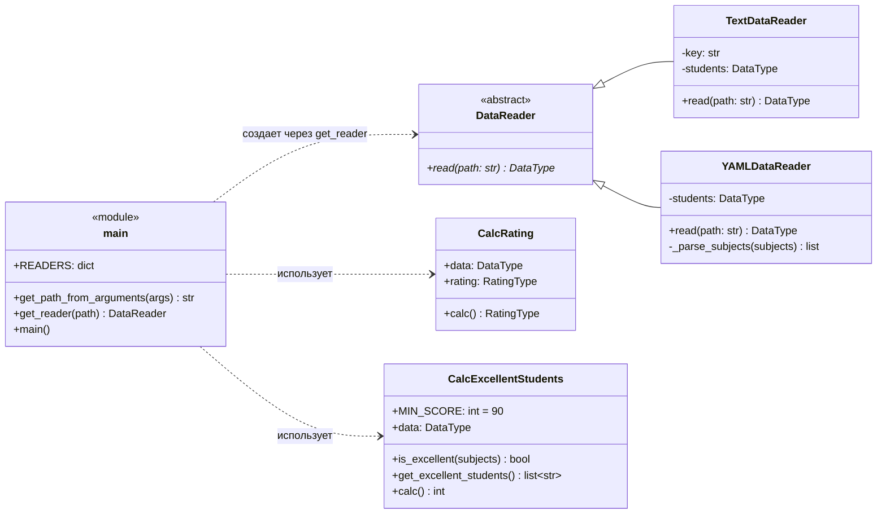

# Лабораторная 1 по дисциплине "Технологии программирования"

[](https://github.com/ShadowShirley/PTLab1/actions/workflows/github-actions-testing.yml)

**Тема:** знакомство с системой контроля версий Git и инструментом CI/CD GitHub Actions.
**Вариант:** 1.

## Постановка задачи

1. Создать проект `rating`, рассчитывающий средний рейтинг студентов по дисциплинам
   (по методическим указаниям), разместить его на GitHub и настроить автоматическое
   тестирование с помощью GitHub Actions.
2. Проверить реакцию CI на ошибку в коде: внести ошибку, получить «красную» сборку,
   исправить ошибку и получить «зеленую» сборку.
3. Индивидуальное задание (вариант 1):
   - выбрать лицензию и добавить ее в проект (выбрана **MIT**, файл `LICENSE`);
   - добавить файл `.gitignore`;
   - добавить класс-наследник `DataReader` для чтения входного файла формата **YAML**
     и модульные тесты к нему (ветка `feature/yaml-reader`);
   - добавить класс, рассчитывающий и выводящий на экран **количество
     студентов-отличников** (баллы по всем предметам ≥ 90), и модульные тесты к нему
     (ветка `feature/excellent-students`);
   - составить UML-диаграмму классов;
   - проанализировать результаты и сделать выводы.

## Описание проекта

```
rating
├── .github/workflows/github-actions-testing.yml   # конвейер CI (GitHub Actions)
├── data
│   ├── data.txt                  # входные данные в текстовом формате
│   └── data.yaml                 # входные данные в формате YAML (вариант 1)
├── src
│   ├── Types.py                  # псевдонимы типов для Type Hints
│   ├── DataReader.py             # абстрактный класс чтения данных
│   ├── TextDataReader.py         # чтение .txt
│   ├── YAMLDataReader.py         # чтение .yaml / .yml  (новое)
│   ├── CalcRating.py             # расчет среднего рейтинга
│   ├── CalcExcellentStudents.py  # подсчет отличников   (новое)
│   └── main.py                   # точка входа, выбор читателя по расширению файла
├── test                          # модульные тесты pytest
├── LICENSE
├── README.md
└── requirements.txt
```

Формат YAML-файла:

```yaml
- Иванов Иван Иванович:
    математика: 67
    литература: 100
    программирование: 91
- Петров Петр Петрович:
    математика: 78
    химия: 87
    социология: 61
```

`YAMLDataReader` разбирает файл через `yaml.safe_load`, проверяет структуру
(корень — список, каждая запись — словарь «ФИО → {предмет: балл}») и при нарушении
формата бросает `ValueError`. `main.py` выбирает класс-читатель по расширению файла
(`.txt` → `TextDataReader`, `.yaml`/`.yml` → `YAMLDataReader`).

`CalcExcellentStudents` возвращает список отличников (`get_excellent_students()`) и их
количество (`calc()`). Студент без оценок отличником не считается.

### Запуск

```bash
python -m venv .venv && source .venv/bin/activate
pip install -r requirements.txt
pycodestyle src test
PYTHONPATH=./:./src/ pytest test
python src/main.py -p data/data.yaml
```

Пример вывода:

```
Rating:  {'Иванов Иван Иванович': 86.0, 'Петров Петр Петрович': 75.33..., 'Сидорова Анна Сергеевна': 95.0, 'Козлов Дмитрий Андреевич': 95.0}
Excellent students:  ['Сидорова Анна Сергеевна', 'Козлов Дмитрий Андреевич']
Number of excellent students:  2
```

## Используемые технологии

- Python 3.10+ (Type Hints), `argparse`, `abc`
- PyYAML — разбор YAML
- pytest — модульное тестирование (фикстуры, `tmpdir`, `monkeypatch`, `capsys`, параметризация)
- pycodestyle — проверка соответствия PEP 8
- Git (ветки, `--no-ff` слияния), GitHub, GitHub Actions (матрица Python 3.10 / 3.12)

## UML-диаграмма классов



## Ход работы (история Git)

| Шаг | Коммит / ветка |
|-----|----------------|
| Исходный проект из методички | `My first commit` |
| Проверка CI: внесена ошибка → сборка упала (`assert 64.0 ± 0.001 == 85.3333`) | `Introduce deliberate error ...` |
| Ошибка исправлена → сборка зеленая | `Fix deliberate error ...` |
| Лицензия и `.gitignore` | `Add MIT license and .gitignore` |
| YAML-читатель + тесты | ветка `feature/yaml-reader` → merge в `main` |
| Подсчет отличников + тесты | ветка `feature/excellent-students` → merge в `main` |

Покрытие тестами (`coverage run --source=src -m pytest`): **98 %** (33 теста);
не покрыты только тело абстрактного метода и строка `if __name__ == "__main__"`.

## Выводы

1. Git позволяет хранить полную историю изменений проекта; ветки дают возможность
   вести разработку новых функций изолированно и вливать их в `main` только после
   прохождения тестов.
2. GitHub Actions автоматически запускает проверку стиля (pycodestyle) и тесты (pytest)
   при каждом push в `main` и на pull request. Эксперимент с намеренной ошибкой показал,
   что сломанный код сразу обнаруживается: сборка помечается красным крестиком, а лог
   показывает упавший тест.
3. Абстрактный класс `DataReader` упростил расширение: поддержка YAML добавлена новым
   классом без изменения существующих (принцип открытости/закрытости), а выбор
   реализации вынесен в словарь `READERS`.
4. Модульные тесты покрывают как штатные сценарии, так и граничные (балл ровно 90 и 89,
   пустой файл, студент без оценок, некорректная структура YAML).

## Ответы на контрольные вопросы (кратко)

1. **СКВ** — система, хранящая историю изменений файлов. Локальные (RCS) хранят версии
   на одной машине; централизованные (SVN, CVS) — на одном сервере (единая точка
   отказа); распределенные (Git, Mercurial) — у каждого участника полная копия
   репозитория. Git хранит снимки (snapshots), почти все операции локальны,
   целостность обеспечивается хешами SHA-1/SHA-256.
2. `git init` — создать репозиторий в текущей папке; `git clone <url>` — получить копию
   удаленного репозитория со всей историей.
3. Состояния файла: *modified* (изменен в рабочей копии), *staged* (проиндексирован —
   `git add`), *committed* (зафиксирован — `git commit`). Основные команды: `status`,
   `add`, `commit`, `log`, `diff`, `branch`, `checkout/switch`, `merge`, `pull`, `push`,
   `remote`.
4. Лицензии, предлагаемые GitHub: разрешительные (MIT, BSD, Apache 2.0 — разрешают почти
   всё, Apache дополнительно дает патентную защиту), копилефт (GPL v2/v3, AGPL, LGPL —
   производные работы должны распространяться под той же лицензией), MPL 2.0
   (слабый копилефт на уровне файлов), Unlicense/CC0 (общественное достояние).
5. **CI** — частое слияние изменений в общую ветку с автоматической сборкой и тестами;
   **CD** — автоматическая доставка/развертывание прошедших проверку версий. CI/CD
   сокращает время обнаружения ошибок и делает выпуск версий предсказуемым.
6. **GitHub Actions** — встроенная в GitHub CI/CD-платформа: workflow описываются в
   `.github/workflows/*.yml`, запускаются по событиям (push, pull_request, расписание),
   выполняют jobs из шагов на раннерах; поддерживает матрицы, кэширование,
   секреты, публикацию артефактов и развертывание.
